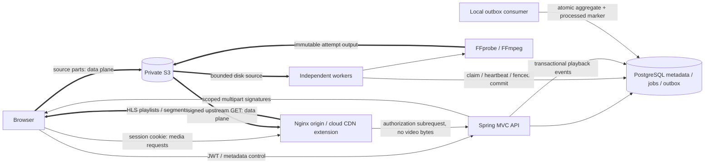

# Requirements and architecture

The implemented product is VOD with creator-owned uploads, metadata CRUD, explicit publish, public/unlisted/private
visibility, full-text search, watch history, comments, likes and explainable recommendations. Authenticated users can
create videos; local identities double as creator profiles. Rich channels, moderation, billing, captions, DASH and
studio DRM are extension work.

## Acceptance and SLO boundaries

Durability means a successful completion response has committed source metadata and a processing job in PostgreSQL; the
source exists with expected byte length. Worker verifies SHA-256 before decoding. READY means every required output was
uploaded and HEAD-verified and the authoritative attempt committed. PUBLISHED is an independent boolean enabled only for
READY media. Deletion immediately denies new authorized origin requests; physical erasure is separate.

Targets (unverified): regional playback-session p99 <100 ms at specified load, 99.99% monthly successful authorized API
requests excluding invalid input, p95 startup <2 s on a stated device/network and warm CDN. QoE gate proposal: rebuffer
time / playing time <0.5%; measure with client telemetry before setting a contractual SLO. Database/source RPO zero
within the durability envelope of deployed synchronous multi-AZ services; local Compose has no availability guarantee.

## Alternatives

| Architecture          | Benefit                                                             | Cost / choice                                                     |
|-----------------------|---------------------------------------------------------------------|-------------------------------------------------------------------|
| Modular API + workers | Minimal operations, transactional metadata, independent CPU scaling | Selected; shared database is scaling boundary                     |
| Domain services       | Independent teams, failure budgets and deployment                   | Extra distributed workflows; split only after measured contention |
| Global active-active  | Local authorization and regional continuity                         | Ownership/conflict and replication complexity; extension          |

PostgreSQL SKIP LOCKED jobs have durable leases, unlike holding a broker consumer open for hours. Kafka is appropriate
for high-volume analytics fanout but unnecessary for this baseline. Events are a transactional outbox consumed inside
the same database transaction as the local aggregate; no Kafka exactly-once claim. Redis can accelerate public
candidates but must never authorize private media.

## Transactions and consistency

Upload create reserves quota under an account row lock, establishes a provider upload, and persists its ID. These cannot
atomically commit: an ambiguous initiation can leak a provider multipart upload; lifecycle expiration is mandatory.
Completion serializes per upload, completes storage, HEAD-checks size, moves reservation to used, and inserts a
job/event in one transaction. HEAD recovery makes a lost complete acknowledgment retryable. An expired upload reconciler
completes already-present sources or aborts incomplete provider uploads. S3 calls within bounded database transactions
favor simple serialization but hold connections; production should split these into short CAS phases with a COMPLETING
state at higher ingress concurrency.

Workers claim with SKIP LOCKED, heartbeat every 15 s with a 90 s lease, retry at most three times, and use UUID attempt
prefixes. A fenced final transaction checks the current attempt and rejects stale workers. A crash after output upload
leaves unreferenced immutable objects; never overwrite published outputs. Source checksum failures never reach READY.
Publish updates metadata with required If-Match version. Database checks prohibit published media lacking
READY/current_attempt. Video deletion is checked during fenced publication.

## Multi-region

Begin single region with multi-AZ managed PostgreSQL and object storage, regional workers and global CDN. Active-passive
metadata recovery with WAL/PITR: proposed RPO <=5 min, RTO <=30 min, both requiring drills. Replicate immutable media
asynchronously; mark a version region-available only after object inventory/manifest checks. During region loss route
authorization to standby after fencing old writer; cached authorized media can continue only within explicitly accepted
credential lifetime. Active-active needs a home region per creator/video and conflict policies for likes/history; never
assume immediate S3 replication.
