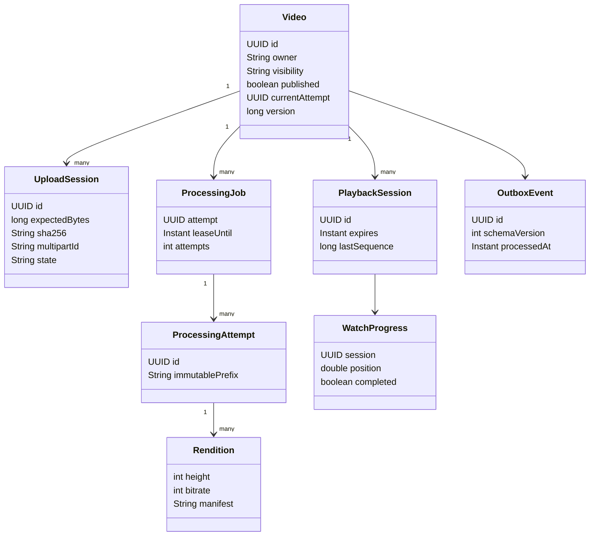
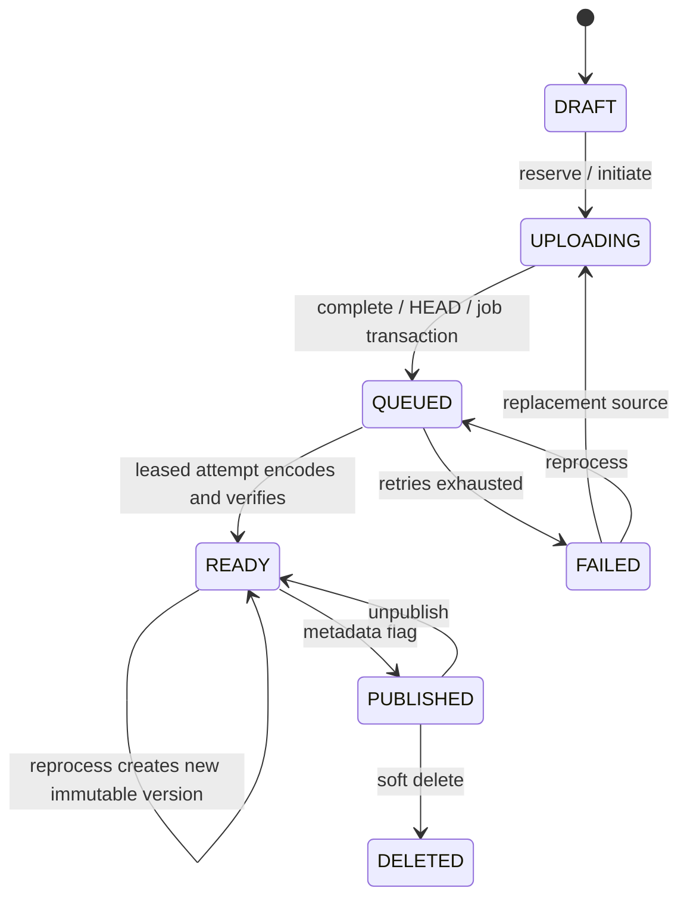
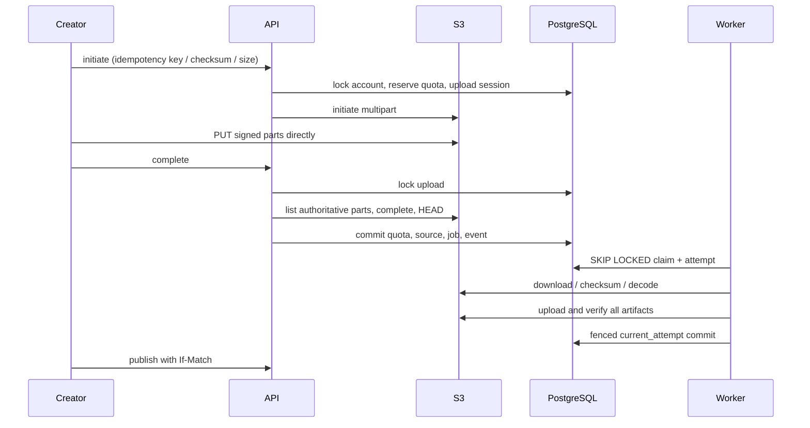
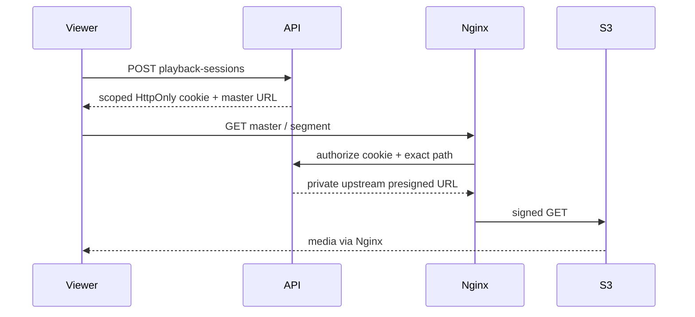

# Low-level design

JDBC is used for explicit locks, SQL CAS and queue claims. DTOs are Java records. Domain identifiers are UUIDs,
identities are OIDC subjects. The modular packages use a small shared database facade; extracting repository ports into
standalone domains is appropriate as independent implementations emerge. This is pragmatic modular code, not full
framework-heavy DDD.

Processing detail stays on job/attempt rows rather than overloading video state: QUEUED/RUNNING/SUCCEEDED/FAILED.
Validation, encoding, packaging and verification occur within an attempt. Only one active job per video is permitted by
a partial unique index. One authoritative current_attempt references the winning version. Version increments on metadata
and successful processing commits.

Repositories: Db.one/video/own/readable are shared JDBC adapters; Storage encapsulates AWS SDK. Application services use
TransactionTemplate or @Transactional. Error contract is Problem Details; invalid payload 400, authentication 401,
missing/hidden 404, owner 403, invalid transition/stale version 409. Database uniqueness conflicts map to 409. OIDC
subject rather than user-provided owner fields governs all writes.

Watch progress uses a strictly increasing sequence per session. Duplicate/old sequence is ignored. Newest-created
session wins across devices; seeking backward is allowed within that session. The completed field is derived from >=95%
position. Client sends every 15 s, so last seconds can be lost on browser close. Qualified view requires both elapsed
wall time and reported position >=min(30 s,80% duration), once per session, then async transactional aggregation. This
is a transparent baseline, not fraud-resistant unique-human measurement.

Retention proposal: playback sessions 24 h after expiry, raw events 30 days, progress 365 days inactive, unreferenced
attempts 7 days, deleted sources after legal hold. Retention/physical deletion automation remains a production gate.
Partition raw events by month when measured volume warrants; indexes bound live queue and catalog access. Migrations use
expand/backfill/contract; do not remove old columns during mixed-version rolling deployment.

The governance/retention extension adds channels, moderation_decisions, erasure_jobs and playback session purpose
(WATCH/REVIEW). See migrationsV2–V6 and hardening.md. REVIEW sessions are scoped/audited and excluded from progress/view
aggregation.
